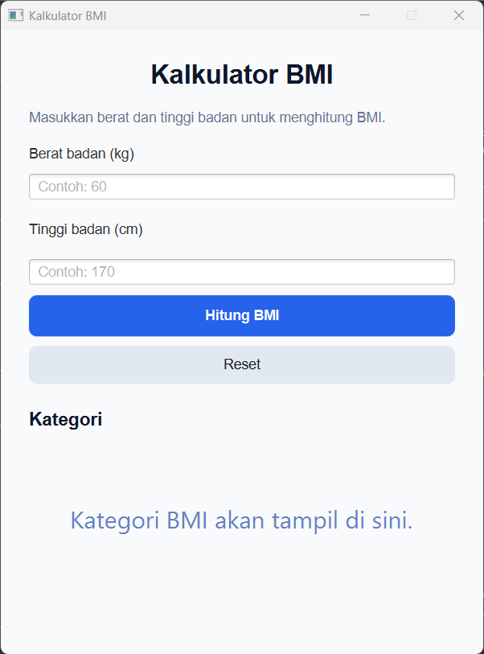

# Kalkulator BMI

Aplikasi berbasis Java untuk menghitung Indeks Massa Tubuh (Body Mass Index / BMI) guna membantu mengetahui status berat badan ideal.

---

## 1. Deskripsi
Kalkulator BMI adalah program sederhana yang menghitung nilai BMI berdasarkan input fisik pengguna, lalu mengelompokkannya ke dalam kategori berat badan standar kesehatan.

## 2. Cara Kerja
1. Pengguna memasukkan data **Berat Badan** dalam satuan kilogram (kg).
2. Pengguna memasukkan data **Tinggi Badan** dalam satuan sentimeter (cm).
3. Program mengonversi tinggi badan ke meter, lalu menghitung nilai BMI menggunakan rumus:

> **BMI = Berat Badan (kg) / (Tinggi Badan (m))²**

## 3. Kategori BMI
Hasil perhitungan BMI dikelompokkan ke dalam kategori berikut:

| Rentang Nilai BMI | Kategori |
| :--- | :--- |
| < 18.5 | Berat Badan Kurang (Underweight) |
| 18.5 – 24.9 | Berat Badan Normal (Normal weight) |
| 25.0 – 29.9 | Kelebihan Berat Badan (Overweight) |
| ≥ 30.0 | Obesitas (Obese) |

## 4. Teknologi
* **Java** 
* **Apache Maven**
